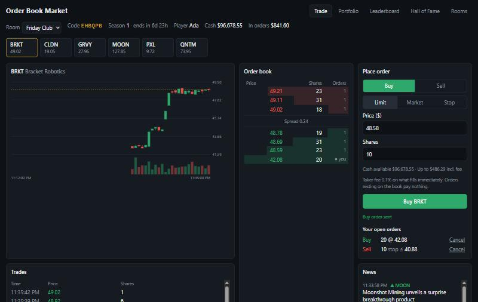
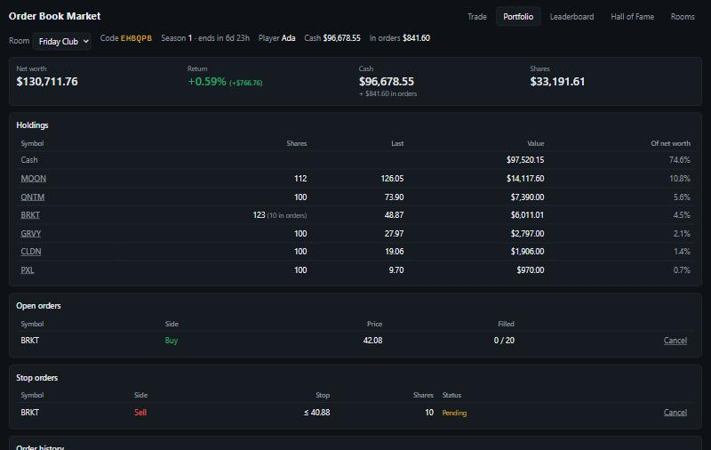
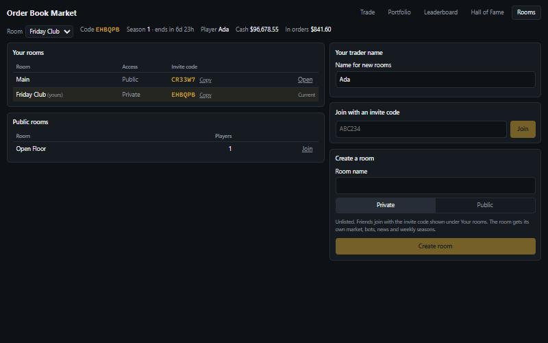

# Order-Book Marketplace

[](https://github.com/Fegi176/OrderBookMarket/actions/workflows/test.yml)

A multiplayer stock-exchange game on [SpacetimeDB](https://spacetimedb.com) with a real price-time-priority order book. Players trade six made-up companies against each other and against bots. News moves prices, and a weekly season crowns a winner. Play in the public Main room, or create a private room and share its invite code with friends. See [SPEC.md](SPEC.md) for the original design.

The server is a TypeScript SpacetimeDB module. Every order is matched inside one reducer, so matching is a single atomic transaction. The client is React, and it gets live updates through SpacetimeDB subscriptions.



| Portfolio | Rooms |
| --- | --- |
|  |  |

## Features

- **Matching engine.** Limit, market and stop orders are matched by price-time priority. Trades happen at the resting order's price, and cash or shares are set aside when an order is placed. Your orders never match your own.
- **Fees.** Takers pay 0.10%; resting (maker) orders pay nothing.
- **Bots.** A market maker keeps every book two-sided, and a noise trader adds flow.
- **News.** Random events move each company's hidden fair value, and prices drift toward it.
- **Rooms.** A public Main room, public rooms listed in a lobby, and private rooms joined with a 6-character invite code. Each room is its own market with its own balances, bots, news, seasons and leaderboard.
- **Seasons.** Each room runs weekly seasons. At the end, standings are saved to a Hall of Fame and the room's market resets.
- **Live client.** A candle chart, aggregated depth, trade feed, portfolio, leaderboard, and stop and order history. All of it is subscribed per room and per symbol.

## Layout

```
server/              SpacetimeDB module (TypeScript)
  src/schema.ts      tables and indexes; every market table is keyed by room
  src/rooms.ts       creating and joining rooms, invite codes
  src/engine.ts      matching engine, reservations, market orders, cancel, taker fees
  src/stops.ts       stop orders: place, cancel, and trigger after trades
  src/candles.ts     last price and one-minute candle roll-up
  src/bots.ts        market-maker and noise-trader bots, run in every room
  src/news.ts        random news events that move each company's hidden fair value
  src/seasons.ts     weekly seasons per room: save standings, reset the market
  src/standings.ts   net-worth ranking shared by the leaderboard and season results
  src/prune.ts       keeps bot-only history from piling up
  src/identities.ts  the module-owned bot and Exchange identities
  src/index.ts       reducers, scheduled reducers, and views
  tests/             module tests on the SDK's in-process test datastore
client/              React + Vite
  src/module_bindings/   generated by `spacetime generate` (do not edit)
  src/components/        trading view, portfolio, leaderboard, Hall of Fame, rooms
  src/lib/market.ts      pure depth, tick and portfolio calculations
  src/test/              test setup and a stand-in for spacetimedb/react
.github/workflows/       CI: typecheck, tests with coverage, and build for both packages
```

## Testing

Neither suite needs a running database. In `server/` or `client/`:

```bash
npm install
npm test
```

Run `npm run coverage` for a coverage report (HTML in `coverage/`).

| Suite | Tests | Statements | Branches |
| --- | --- | --- | --- |
| Server module | 71 | 99.5% | 95.1% |
| React client | 63 | 98.2% | 90.9% |

**Server** tests (`server/tests/`) run the real module against the SDK's in-process datastore. They call reducers as players, bots and the scheduler, then read the tables back.

| File | What it covers |
| --- | --- |
| `engine.test.ts` | Price-time matching, partial fills, self-trade skip, cancel, market orders |
| `engine.test.ts` | 1,000 random orders: total cash and shares conserved, and reservations equal what open orders and stops hold |
| `rooms.test.ts` | Creating rooms and joining them with invite codes |
| `rooms.test.ts` | Isolation between rooms: balances, books, prices, bots, news, seasons and leaderboards |
| `rooms.test.ts` | Which rooms and codes each view reveals |
| `validation.test.ts` | Every rejection a client can trigger, each proven to roll back |
| `stretch.test.ts` | Fee maths and maker/taker rules, stop orders (trigger, cascade, failure, cancel) |
| `bots.test.ts` | Bot quoting, fair-value convergence, news, no row pile-up |
| `seasons.test.ts` | Season rollover and reset |
| `leaderboard.test.ts` | Leaderboard valuation |
| `candles.test.ts` | Candle roll-ups |
| `prune.test.ts` | History pruning |

**Client** tests (`client/src/**/*.test.tsx`) use Vitest, Testing Library and jsdom. `src/test/spacetime.ts` replaces the SpacetimeDB React hooks with fixtures and reducer spies, so components render without a server.
- Unit tests cover parsing and formatting. For example, `"0.29"` becomes exactly 29 cents, where `parseFloat` gives 28.999…
- Unit tests cover depth aggregation, trade ticks and portfolio maths.
- Component tests drive every page as a user would: trading, portfolio, leaderboard, Hall of Fame, rooms, joining by code, and switching rooms. They assert on what's shown and the exact reducer arguments, including room ids and integer-cent prices.

## Run locally

Install the SpacetimeDB CLI from https://spacetimedb.com/install, then from the repo root:

```bash
spacetime start
```

```bash
spacetime publish --server local --module-path server order-book
```

```bash
cd client && npm install && npm run dev
```

Open http://localhost:5173. After changing tables or reducers, republish and regenerate the bindings with `npm run generate` in `client/`. If a change breaks the existing schema (for example a new column), add `--delete-data=always` to the publish command; this wipes the local database.

Each browser origin keeps its own identity. To play against yourself, run a second client with `npm run dev -- --port 5174`, or use a private window. Create a private room in one and join it from the other with the invite code.

`VITE_STDB_URI` and `VITE_STDB_DB` override the server address (`ws://localhost:3000`) and database name (`order-book`).

## Design notes

**Money and matching**
- Money is integer cents and quantities are whole shares, all `u64` (`bigint` in TS). No floats are involved anywhere.
- Time priority uses a private `order_seq` counter, not timestamps.
- Placing an order reserves cash (buys, at the limit price) or shares (sells). Fills settle at the resting order's price and refund any price improvement to the buyer.
- Market orders are immediate-or-cancel: they fill what they can and the rest is cancelled, never rested.
  - Buys stop when the next share is unaffordable.
  - A market order that fills nothing is rejected, and it rejects before writing anything, so bots and stop triggers can catch the error safely.
- Self-trades are skipped: your own resting orders are passed over and stay on the book.
- Takers pay a 0.10% fee (`FEE_BPS`, rounded up to the cent) on the part of an order that executes on arrival. Resting (maker) orders pay nothing.
  - A buy limit reserves the worst-case fee along with its cost and gets back whatever the actual fee didn't use.
  - Fees go to the room's Exchange account, so total cash is still conserved.
  - The fee is recorded per order as `feePaid`.
- Stop orders are stop-market orders kept in the private `stop_order` table. A buy stop must sit above the last price and a sell stop below it.
  - Sell stops reserve their shares on placement. Buy stops reserve nothing and are checked for cash when they fire.
  - After every trade-producing reducer and each bot tick, due stops fire oldest first as market orders. A fill can set off further stops in the same transaction.
  - A stop that can't execute is marked `failed`, with the reason in `note`.

**Rooms**
- Every market table carries a `roomId`: accounts, holdings, orders, stops, trades, candles, prices, fair values, news and seasons. A player has a separate account in each room they join.
- Tables that need a room-wide pass have a single-column `roomId` index. Multi-column indexes are always looked up by their full key, because the SDK's unit-test harness can't decode prefix scans.
- The `room` table is private because it holds invite codes. The `public_rooms` view lists public rooms without codes, and `my_rooms` shows codes only for rooms you're in.
- Private rooms are unlisted and need the code to join. Their book and trades are still published like any other room's, so they're private from the lobby, not secret.
- Codes are 6 characters from an alphabet without look-alikes (no 0/O or 1/I/L). Joining by code ignores case and spaces.
- `init` creates the public Main room, where every new player lands.
- Players may create up to 3 rooms, because each room runs its own bots and news.

**Bots and news**
- Bots trade through the same engine as players, under fixed module-owned identities that have an account in every room.
- `run_bots` runs every 3 seconds across all rooms.
  - The **Liquidity Bot** keeps 3 bids and 3 asks per symbol around an anchor that closes 25% of the gap between the last price and fair value each tick. Quotes are only replaced when incomplete or off-centre, and replaced quotes are deleted.
  - The **Noise Bot** sends small market orders, leaning toward buying below fair value and selling above it.
  - Bot cash and shares are topped up when they run low. That top-up is the one place money enters the game besides joining.
- Each room schedules its own news every 45-120 seconds. An event moves one company's hidden fair value by 1.5-12% and publishes a headline. Fair value lives in the private `market_state` table, so players learn of moves from the news.
- All randomness comes from `ctx.random`, so reducers stay deterministic. Every scheduled reducer rejects calls from clients.

**Seasons, standings and history**
- Each room runs one-week seasons (`SEASON_LENGTH_MICROS`), and `end_season` is scheduled for the exact end time. In one transaction it:
  1. saves the room's standings to `season_result`;
  2. clears the room's orders, stops, trades, candles and news;
  3. resets players to $100,000 and 100 shares of each company;
  4. puts prices back to listing;
  5. opens the next season.

  Other rooms are untouched.
- The public `leaderboard` view publishes each player's name, net worth and starting net worth per room, never balances or positions. Net worth is cash plus every share at its last trade price, and bots are excluded.
- `account`, `holding` and `stop_order` are private. Clients read their own rows, across all their rooms, through `my_accounts`, `my_holdings` and `my_stop_orders`.
- History is pruned so tables stay small within a season. Bots' closed orders are deleted every tick. Every minute, bot-vs-bot trades older than an hour and candles older than three hours are deleted. Anything involving a player is kept until the season resets.
- The client subscribes per room and symbol: open orders, trades and candles for what's on screen only. Depth is aggregated by price in the browser.
